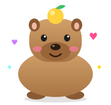
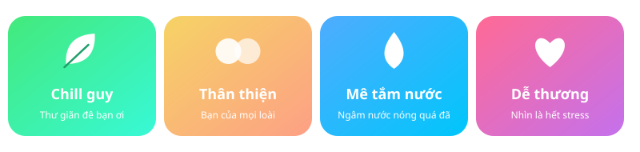

## 👋 About Me

- 🙋 Mình là **MilanVu**, **14 tuổi** **Hic, nhìn tuổi có vẻ hơi phi lí nhưng mình khá thích tìm tòi bộ môn này kaka**
- 🌱 Mới bắt đầu lập trình, vẫn còn **tay mơ** nhưng rất háo hức học hỏi
- 💖 Ngôn ngữ yêu thích: **HTML, Swift, Python  C++**
- 🦫 Yêu **capybara** vãi đáiii
- 📫 Luôn thân thiện và hơi ngốc nghếch kaka

## 🧰 Tech Stack

## 🦫 Capybara 

> 💡 *Học code cũng chill như capybara: từ từ, đều đặn, không vội vàng!*

🎁 <b>Bất ngờ nìii</b>

 

Capybara là loài gặm nhấm **lớn nhất thế giới**. Nếu bạn đang đọc dòng này, chúc bạn một ngày thật quá đã nhaa! 🦫💖

## 🤝 MXH của mìn ở đayyy

&nbsp;&nbsp;
&nbsp;&nbsp;
&nbsp;&nbsp;

  

> ✨ *"Everyone starts as a beginner. Keep coding, stay chill like a capybara!"* 🦫

