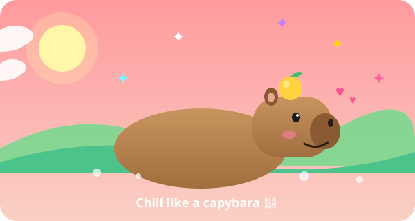

 

## 👋 About Me

<table>
<tr>
<td valign="middle">

- 🙋 Mình là **MilanVu**, **20 tuổi**
- 🌱 Mới bắt đầu lập trình, vẫn còn **tay mơ** nhưng rất háo hức học hỏi
- 💖 Ngôn ngữ yêu thích: **HTML · Swift · Python · C++**
- 🦫 Yêu **capybara** vô điều kiện
- 🎯 Mục tiêu: làm ra những dự án thật của riêng mình
- 📫 Luôn sẵn lòng kết bạn và học hỏi từ mọi người

</td>
<td align="center" valign="middle" width="260">

</td>
</tr>
</table>

## 🧰 Tech Stack

## 🦫 Vì sao mình mê Capybara?

- 🌿 **Siêu chill:** ở cạnh ai cũng bình thản, năng lượng tích cực lan tỏa
- 🤝 **Thân thiện:** làm bạn được với hầu hết mọi loài, từ chim tới khỉ
- 🛁 **Mê tắm nước:** ngâm mình thư giãn là chân ái
- 😍 **Dễ thương:** gương mặt ngố ngố nhìn là hết stress

> 💡 *Học code cũng nên chill như capybara: từ từ, đều đặn, không vội vàng!*

🎁 <b>Bấm vào đây để xem một bí mật nhỏ</b>

 

Capybara là loài gặm nhấm **lớn nhất thế giới**. Nếu bạn đang đọc dòng này, chúc bạn một ngày thật chill! 🦫💖

## 🎯 Mục tiêu năm nay

- [x] Bắt đầu học lập trình 🎉
- [ ] Làm xong 1 trang web đầu tay bằng HTML 🌐
- [ ] Viết vài chương trình nhỏ bằng Python 🐍
- [ ] Thử làm một app đơn giản bằng Swift 🍎
- [ ] Hiểu rõ cơ bản về C++ ⚙️
- [ ] Làm một dự án nhỏ về **capybara** 🦫

## 🤝 Kết nối với mình

 

> ✨ *"Everyone starts as a beginner. Keep coding, stay chill like a capybara!"* 🦫

